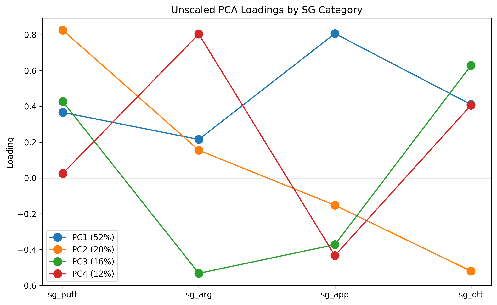
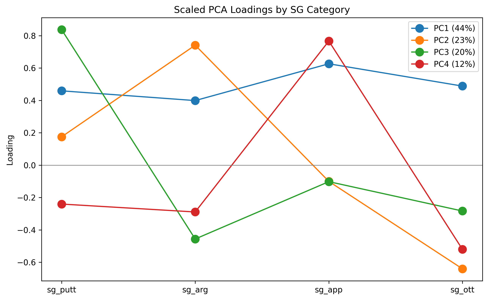

# good-golfer

I am interested in what makes a good PGA Tour golfer. This Kaggle data has info about people who played PGA Tour events from 2015-2022, mostly related to performance in each tournament.

## Background

What makes a good PGA tour golfer has been very widely studied, but not always from a quantitative angle. A few of the books I've read about it are "The 8 Traits of Champion Golfers" (Graham, Stabler), "Golf Is Not a Game of Perfect" (Rotella), and "Dave Pelz's Short Game Bible" (Pelz). The first two books have a psychological focus, but Dave Pelz took a quantitative approach and made some very interesting discoveries.

If you play golf, I would highly recommend the entire book. Even if you don't care about golf, I would highly recommend reading chapters 1-3 and skimming the rest, reading any time you see numbers or charts. I have a huge amount of respect for Pelz, who put a massive amount of effort into collecting high-quality data, and made findings and tools that are now staples (2 ball putter, the 60 degree wedge, and the notion that short game disproportionately affects scoring). Other quantitative studies had been done before("The Search for the Perfect Swing", Cochran and Stobbs, 1968), but they were more limited and didn't really ask the right questions. I will summarize some pertinent information. 

Pelz was a college golfer, but not good enough to earn a living from it. He studied physics and eventually became a PI at NASA's Goddard Flight Center; most of his research focused on atmospheric studies of Earth and other planets. He left the job to try coaching pro golfers, which he did very successfully, with his students winning a total of 21 majors, including as Phil Mickelson, Tom Kite, Vijay Singh, and Lee Janzen.

Pelz collected a huge amount of data by caddying for tour players and recording every shot they made. When he made a name for himself and started coaching players, he also collected tons of their data in more controlled environments. I've inquired after these datasets, and will update this if I get a response. 

UPDATE: They said I couldn't have them. I don't really blame them since it's proprietary and it's how they make money.

Pelz's central finding is that "...short-game performance is more important than either putting or the power game in determining the score a player shoots and how much money he makes on the PGA Tour. Later, I would learn that the same is true for amateurs..." (Pelz 23). By power game, he roughly means full swing shots outside of 100 yards.

I haven't evaluated too many other approaches, but I did have some commentary about a sports analytics blog post by Luke Wisniewski at https://sites.dartmouth.edu/sportsanalytics/2023/02/02/man-vs-nature-the-factors-influencing-pga-tour-scores/. I'll talk about it more in the blog post.

https://www.kaggle.com/datasets/robikscube/pga-tour-golf-data-20152022

## Golf performance metrics for non-golfers
Golf is a complicated game, so comparing how different players perform in different ways is a difficult task. Baseball is notorious for having relatively complicated statistics to quantify how good players are; this approach is newer to golf mostly because the quality of any one shot is particular to the player, hole, weather, and individual performance that day. Most of the statistics that are obvious to create don't really measure how good a shot is, but rather whether it had certain qualities that make them, on average, better than other shots.

The weather can have an enormous impact on how good shots are. You can really only compare the old-fashioned stats with those from other players on the same day. For instance, in terrible weather, playoff holes can sometimes be won by a player who comes in 5 or 7 over par; it just matters whether you do better than everyone else.

If you do play golf and are surprised by PGA tour stats being so low, you should remember that they only play the most difficult courses in the country. When they play normal courses they 

Old-fashioned golf stats:
- Driving distance: average distance off the tee. Although it's one of the most obvious statistics to collect, it really doesn't mean too much at a high level of play(and it only really matters at lower levels because it helps to measure the number of terrible first shots). For example, John Daly led the tour for 11 years in driving distance, but he did not have a stellar career(if you're interested in how this happened, read a little about him on Wikipedia. He is often said to have the greatest wasted talent in golf by a large margin, probably due to substance abuse and maybe a lack of effort).
- Putts: putts in a round. Lower is better generally but it can be misleading; if you have horrible approaches the whole round, you'll chip on and 1 putt a ton, which could give you super low putts.
- GIR: you got on the green in (par for this hole - 2) strokes. Better stat than putts, but occasionally misleading; sometimes(especially on par 3s with huge greens) it's better to miss the green in one particular area than to hit it in another.
- Fairways hit: whether your first shot came to rest in the fairway. Better than Putts and GIR, since you almost always want to hit the fairway. However, still very reductive; some players have good performance off the tee even when their fairways hit is poor(e.g. Bryson DeChambeau, who hits it farther enough than others on average that the loss in accuracy is justified). 
- Up and down %: percentage of times you get on the green and hole out in 2 strokes or better from a position around the green. One of the best stats on this list, since you really do always want this to happen. Most scenarios where this statistic wouldn't represent skill well are highly contrived, but it's definitely possible. I would imagine unusually long drivers might try to drive more greens, which would generally be a good idea since most people are better around the greens than with a partial wedge. You would, however, have much harder up-and-down opportunities than someone who drove less distance and missed a partial wedge in, since misses are much worse from 300+ yards than from 50. 
- Scrambling: percentage of times you make par or better after missing GIR. Another good stat, but it is almost exactly the same as up and down % (since most chips/pitches happen when you miss the green on an approach), so I imagine including both of these in a model could cause multicollinearity issues.

Newer stats:
- Strokes gained: the king of golf statistics, invented by Columbia professor Mark Broadie in 2005. It isn't perfect, but there's really nothing better available currently. The SG(strokes gained) on any particular shot is the number of strokes, on average, you saved in comparison to the average PGA tour player. Note that a greater number is better, unlike raw score or handicap.
Imagine you got a hole in one on a hole where the mean score is 3.0. Then, you saved two strokes: SG=+2.0. Now, imagine the mean score on a different hole is 4.2. You hit a terrible drive to a position where, on average, it takes 3.9 strokes to finish the hole. Your strokes gained is 4.2(avg from former position) - 3.9(avg from curr position) - 1(the stroke you took) = -0.7. You are 0.7 strokes worse off than the average PGA Tour player would be if they took the same shot.

It's not too important to this project, but you can lose more than one stroke on a shot. Imagine if you blew a 20-foot putt by the hole and it wound up in the bunker.

To check your understanding, imagine what the strokes gained would be like for for whiffing a shot(which still counts as a stroke). Now, for making a putt from 1 foot. Now, for missing a putt from 1 foot, and it ends up 1 foot from the hole on the same incline.

A: Exactly -1.0, since you're in the same exact position but lost a stroke; a very small positive number like +0.01, since there was a tiny chance you missed it; a negative number just above -1, like -0.99, since it was very likely but not guaranteed that you made it.

Strokes gained is very powerful, and now most Vegas odds are informed heavily by strokes gained. 

## So, what are we doing?
We are going to see whether we can get any intelligibility from principal components of strokes gained in different categories. This was inspired by an example in my Risk Management class, where PCA on a yield curve actually yields interpretable results (level, slope, and curvature). This is a pretty well known result but it was the first time it was explained to me that way. I was very impressed by the recovery of intelligible principal components.

You may be wondering if the PCs of strokes gained carry any information about what makes a golfer good. It's an important concern, but the answer is **yes**, since 
- strokes gained is intrinsically a metric of how good you are compared to everyone else, and
- all of the variables share the same unit, strokes. So, if some attribute explains 80% of the variation in the strokes gained space, it explains 80% of the variation in score. 

### What are my expectations?

When I was thinking about golf some other time, I guessed that the principal components of being good at golf (as a function of goodness in different areas of play) were probably a level, representing generally how good you are, followed by some component that would measure how unusually good your putting was, and besides that I didn't have a good guess.
I had this image in mind where, if you limit your dataset to certain years, sometimes bond curvature doesn't look like y=x^2 but much more like a vector of just the lowest maturity bond and 0 for every other variable.

In short, I'm expecting a level component and a putting component. I would also not be surprised if the putting component were instead a short game component.

It's worth noting that the ordering of the categories(SG for putting, around the green, approach, and off the tee) is not arbitrary. They are in order of increasing distance from the hole, which is why I expect somewhat interpretable results.

## Results
The unscaled PCA loadings should give us some insight into what makes you save more strokes, which is the same thing as being better. 

This is a histogram of the 2015-2021 average (over tournaments) strokes gained for all players who played during this time and have SG data. Means and variances are contained in the table below. They're all pretty left-skewed.

| Type| Mean | Variance |
| ---- | ---- | ---- |
|putt | -0.2390445179200705 | 0.26301092124380526 |
|arg | -0.15818043753031477 | 0.17268678257202838 |
|app | -0.3332181740849265 | 0.43438522917150796 |
|ott | -0.14879309896669266 | 0.2526351198588163 |

### Why are SG variances the way that they are?
It's hard to read into this as much as I'd like to. One problem is that there are a different number of each type of stroke per round(for example, you may only have a single-digit number of shots around the green, while you have 14ish tee shots, 18ish approaches, and a much higher number of putts). So, round SG is somewhat lacking normalization in this sense.

### Why are SG means below 0?
SG is normalized to 0 over the field for each round. However, a player that makes the cut plays twice as many rounds as one that doesn't, and good players are more likely to make the cut. So, it makes sense that the player average is below 0.

### What do the unscaled results mean? 
Make sure to keep an eye on how much variability each PC acutally explains. As PCA goes, the first one isn't very dominant, and the second, third, and fourth are separated enough to be clearly ordered, but they all still explain a pretty decent amount of variability.

We can see that the first component is level-ish. At the very least, we can say that all four variables are meaningfully the same sign, but the loading for sg_app is around double the others.

The second component is slope-ish, but something doesn't seem quite right. The non-putting loadings make a pretty nice line centered at 0, but sg_putt loading is 0.2 greater than where that line passes through. Hard to interpret, but it is suggestive that putting is more different than around the green than approach is to tee. 

I don't feel very confident interpreting the third and fourth components, but they look like curvature and a fourth-order term. I don't know if there's much to learn there.

We weren't necessarily expecting these results to be super nice, since the variances of these components are very different, which once again preserves interpretability with regard to performance outcomes but hurts interpretability of the relationship between SG stats. We will look at the scaled results for this type of interpretation.

To summarize, it looks like the biggest differences in score come from being unilaterally better than others, and the biggest differences in how players' SG stats look after adjusting for this come from how good they are at short game compared to long game, especially putting compared to long game.

### What do the scaled results mean?
You can think of this as comparing how being skilled at each thing, normalized, changes with being skilled at the other things. This should give some very strong indication towards which skills are most related to others.

Once again, look at how much variability is actually explained by each PC. This one is a bit different; the second and third are closer, and together explain more than in the unscaled example. 

These are much more interpretable:
- First PC: clearly a level.
- Second: appears to measure slope of everything but putting.
- Third: roughly measures how different your putting is from everything else. Remember, this one explains almost as much variation as the second!
- Fourth: More or less explains how much better your approach game is than everything else.

These are some interesting results. The relationship between the second and third PCA seems to vindicate the age-old notion that putting skill is less related to other elements of one's game.

## Flaws in this project
This project certainly doesn't tell you how to get better at golf. They say putting is more of a talent (that is, less teachable or improvable) than full swing shots, they say putting performance by day has a lot of variation, they say blah blah blah...

It's also only for PGA Tour pros. I feel almost certain that if you did the same analysis on an amateur dataset, you would get dramatically different results.

## Considerations for improvement:
- I think winnings proportions haven't changed since 2019, and even then not by much, but it would improve results to use the correct table for each year.
- Newer and older data could behave differently. It would be interesting to compare with this.
- Calculate exact winnings, which may be difficult with this dataset.
- Normalize winnings as a proportion of all prize money to defeat prize increase issues.

## Broader things I've learned from this project:

I didn't really get why level, slope, and curvature dominate the yield curve, and other curves like this one to some extent, but I did a little research after this project and this has been discussed before.

This pattern of PCs shows up in data with a natural order(e.g. maturities for yield curve, distance from hole in this data) and neighboringn data points' motion is correlated. Each PC tries to explain as much variation as possible, which are, in order,
- Level. Generally, the shape with the most variance is just everything moving together.
- Slope. It needs at least one sign change since it is orthogonal to level, which is all-positive. Typically, the highest-variance way is for everything to have a consistent difference, since there is autocorrelation. 
- Curvature and higher order. It needs to be orthogonal to the first two, which takes two sign changes. Variance drops off fast since each extra wiggle means less autocorrelatory behavior.

If you're interested, this kind of thing is more formally treated in spectral theory, more specifically in the study of oscillatory systems. I hadn't heard of this stuff at all before.